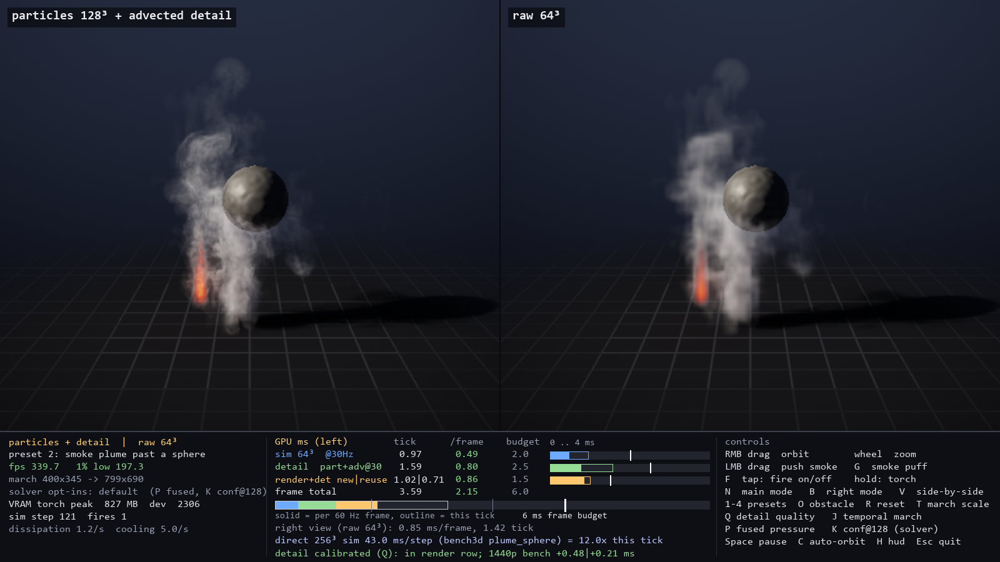
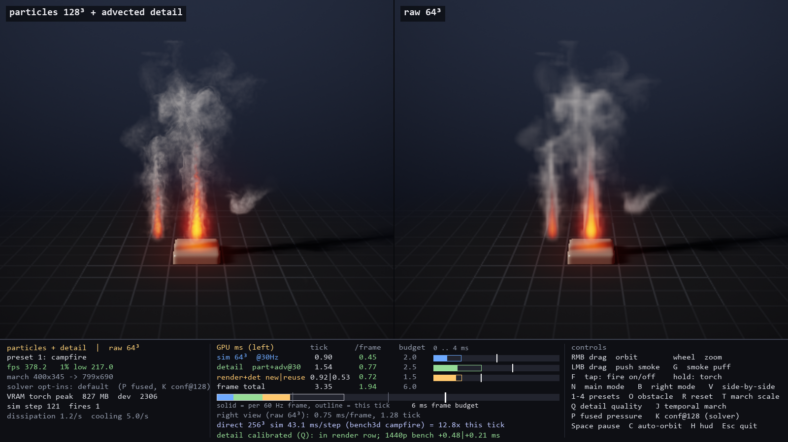
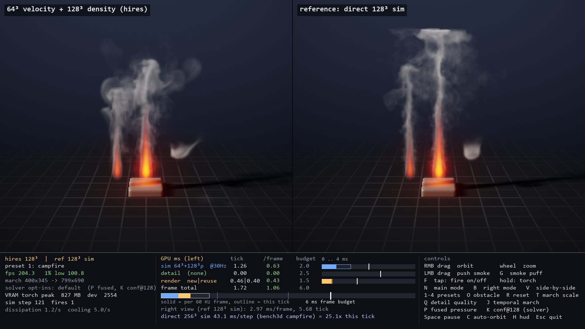
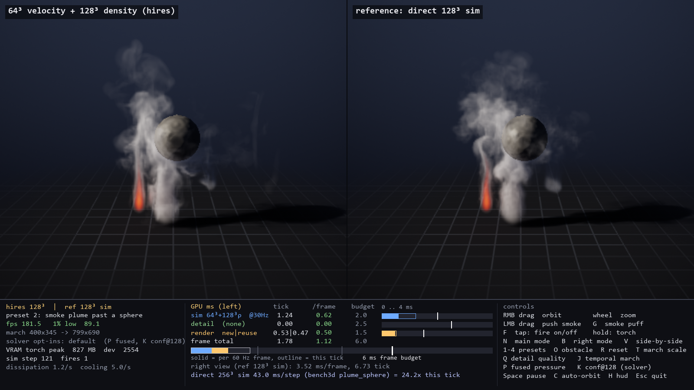
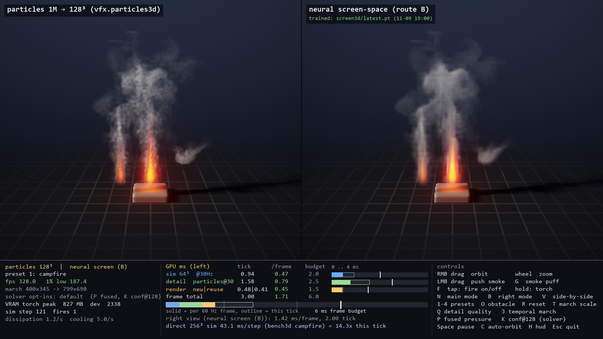
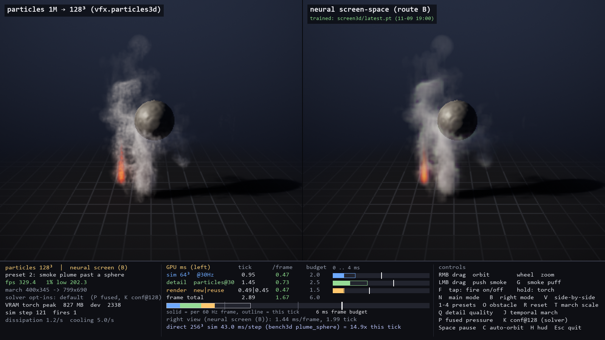

# Neural VFX — real-time smoke and fire experiments

A research prototype that asked one question: can a cheap 64³ fluid sim be made to look like an expensive 256³ one
in real time, with a learned detail stage, inside a 6 ms GPU budget on an RTX 5080?
Design: [SPEC.md](SPEC.md). Conventions and module contracts: [CLAUDE.md](CLAUDE.md).

**Status (2026-11-10): wrapped up as a tech demo. It is not game ready** — it runs in Python, in one 1 m box,
with one fixed light, and has never been integrated into an engine.



## Findings
| Question | Answer | Evidence |
|---|---|---|
| Does a learned 4× detail network work in 2D? | **Yes.** 79% lower spectrum error than bicubic at 60.7 fps, ~1.8 ms GPU per frame. | section "2D demo" below, vfx/train/EXPERIMENTS.md |
| Does a learned detail network work in 3D? | **No, not in budget.** A volumetric 64³→256³ upscaler is too slow unless the volume is sparse; a screen-space network fits the budget but only sharpens edges and adds no wisps. A teacher with 5× the compute, a sharper 320³ target and adversarial training did not change that. | vfx/train3d/EXPERIMENTS.md |
| What does produce fine detail in 3D? | **Detail carried by the sim, no network:** a 128³ smoke field, 1M particles and advected noise, all moved by the 64³ velocity. 5–9× closer to the 256³ reference than the raw sim on our metrics. | bench3d/results/MODES.md |
| What does it cost? | **About 2 ms GPU per frame** for the best mode (softer 128³-smoke mode: about 1 ms) in the sandbox; a direct 256³ sim step is 43 ms. | cost table below |
| Is a learned solver correction worth it? | **No.** One classical parameter (`confinement_ref_res`) fixes most of the 64³ over-stirring; the learned correction adds 11% with no visible difference. | vfx/correct3d/README.md |
| How does it compare with Unreal's Niagara Fluids? | **Unmeasured.** From published sources only: likely ahead on live cost and pressure solve, far behind on lighting, collision, caching and artist tools. No like-for-like test was run. | reports/Niagara Fluids versus our pipeline.md |

Method lessons that cost us time: fluid velocity is not image motion (use camera-only reprojection); flicker metrics
reward blur; pixel-aligned losses and gates reject real detail that is shifted by two pixels, so quality is scored with
shift-tolerant metrics (`vfx/eval3d`).

### Pictures (left | right, 64³ sim unless stated; the HUD shows GPU cost)
| | Campfire | Smoke past a sphere |
|---|---|---|
| best mode \| raw |  |  |
| soft 128³ smoke \| real 128³ sim |  |  |
| particles \| screen-space network |  |  |

All four scenes: reports/images/modes/. Close-up crops against the 256³ reference: reports/images/best_vs_reference_crops.png.

### What is not done
- Fire is the weak spot: particle modes put a speckled grain into flames, and they sit shorter than the reference.
- No engine integration, scene lighting, collision with game geometry, level of detail, caching or artist tools.
- Tested with one effect, on one GPU (RTX 5080). Nothing on weaker cards or consoles.
- A native D3D12 + DirectML runtime (no Python) is on branch `native-runtime`. It has only the screen-space network
  path, and its numbers have not been independently verified.
- Datasets and checkpoints are not in the repo; the pipeline commands below rebuild them.

### Setup
Windows 11, RTX-class GPU, Python venv with PyTorch (CUDA) and NVIDIA Warp 1.19. Big artifacts live in
`%LOCALAPPDATA%/neural-vfx` (override with `VFX_DATA`).

## 2D demo
### Run it
```
.venv/Scripts/python -m vfx.app.main
```
| Key | Action |
|---|---|
| N | cycle mode: LR raw 128² → classical bicubic → neural |
| V | side-by-side bicubic \| neural |
| LMB drag | push the smoke |
| RMB | paint smoke |
| F | tap: toggle a fire at the cursor · hold: torch |
| 1–4 | presets: campfire, smoke stack + obstacle, twin torches + wind, box obstacle (out-of-distribution) |
| O / R / Space / H / Esc | obstacle, reset, pause, HUD, quit |

## Measured, 2D demo (RTX 5080, idle GPU, 2026-11-09, checkpoint v3_seq_run1, solver 0.2.0)
- Windowed, neural side-by-side: 60.7 fps, 1% low 56.2 fps (spec >= 60 / >= 50)
- GPU per stage: sim 0.76 ms, neural upscale 0.71 ms, render 0.17 ms, frame ~1.8 ms (budget 6 ms)
- Detail vs bicubic on the live-style 128² sim input: spectrum error 79% lower on test scenes, 71% on unfamiliar scenes (spec gate >= 50%)
- Flicker vs high-res reference (spec gate <= 1.2x): 0.65 test, 0.65 unfamiliar, 0.50 live fire, 1.01 live smoke + obstacle (bicubic: 0.88, 0.85, 0.64, 1.37)
- Trained on dataset v3: the 512² sim is steered to follow the independent 128² sim the app runs. History in vfx/train/EXPERIMENTS.md.
- Known gaps: a few small detached wisps at plume edges; faint dark rim at the smoke boundary in preset 3.

## Pipeline
```
.venv/Scripts/python -m vfx.datagen.build --version v3 --guided --n-train 200 --n-test 32 --n-ood 32 --frames 16   # ~2 min, 5.9 GB in %LOCALAPPDATA%/neural-vfx
.venv/Scripts/python -m vfx.train.train_seq --config vfx/train/configs/v3_seq_ft.json  # 15 min per run
.venv/Scripts/python -m pytest tests -q          # set VFX_DATASET=v3 first; the default v1 dataset predates the current solver
.venv/Scripts/python -m bench.run
```

## 3D sandbox — current best (2026-11-10)
```
.venv/Scripts/python -m vfx.app3d.main --best          # particles + calibrated sim-carried noise + faster pressure solve, next to untouched raw 64³
.venv/Scripts/python -m vfx.app3d.main --best-light    # same without particles (cheaper)
```
Orbit with RMB drag, zoom with the wheel, LMB drag pushes smoke, F fire, G smoke puff, 1–4 presets, V side-by-side,
N / B change the left / right mode, Q detail quality, P faster pressure solve, K resolution-consistent swirl strength,
C auto-orbit. Every earlier mode is still there (raw, trilinear, neural_vol, neural_screen, ref128, detail, hires, ...).
Full controls: vfx/app3d/README.md. State before this phase: git tag `v0.3-screen-space-baseline`.

### How fine detail is produced
Detail is carried by the 64³ sim, not invented on the image:
- `vfx/detail3d` — noise coordinates advected by the 64³ velocity, sampled inside the ray-marcher (no 256³ volume is written).
- `vfx/particles3d` — 1M particles advected by the 64³ velocity, deposited into a 128³ volume each sim step.
- `vfx/sim3d` opt-ins — `fused_config()` pressure solve, `scalar_res=128` smoke field, `confinement_ref_res=128`.
The screen-space network (`vfx/runtime3d.ScreenDetail`) sharpens but does not produce wisps: an unconstrained teacher
network (5× the compute) and a sharper 320³ target both failed to change that (vfx/train3d/EXPERIMENTS.md).
Background: reports/Real time neural smoke techniques.md.

### Quality vs the steered 256³ reference (four held-out presets, lower is better, reference = 0)
| Approach | detail by scale | patch statistics | motion match |
|---|---|---|---|
| raw 64³ | 0.359 | 0.220 | 0.440 |
| screen-space network (regression) | 0.088 | 0.125 | 0.305 |
| screen-space network (adversarial; rejected on pictures) | 0.051 | 0.068 | 0.194 |
| sim-carried noise, calibrated | 0.119 | 0.080 | 0.167 |
| particles 1M @128³ | 0.118 | 0.075 | 0.129 |
| **particles + calibrated noise (`--best`)** | **0.051** | **0.041** | **0.050** |
Crops: reports/images/best_vs_reference_crops.png. All approaches and metrics: bench3d/results/MODES.md.

### Cost on an idle RTX 5080 at 2560×1440, half-resolution march (budget: sim 2.0 / detail 2.5 / render 1.5 / frame 6.0 ms)
| Stage | ms |
|---|---|
| 64³ sim step, default / faster pressure solve | 0.88–1.01 / 0.48–0.62 |
| + 128³ smoke field | +0.38 |
| sim-carried noise, per sim step | 0.08–0.11 |
| particles 1M @128³, per sim step | 1.41 |
| render: plain / with calibrated noise (average of new-volume and reuse frames) | 0.74 / 1.08 |
| `--best` in the sandbox (800×690 views), per 60 Hz frame | ~2.0 (sim 0.32, detail 0.79, render 0.85) |
| direct 256³ sim step, for comparison | 43 |
Windowed `--best`: 60.6 fps, 1% low 55.7 (frame-capped).

### Known gaps
- Fire: particle modes put a speckled grain into flames; the 256³ reference flame is smooth and taller.
- The 64³ sim over-stirs plumes; `confinement_ref_res=128` fixes most of it (error vs a free-running 128³ sim 4.61 → 1.75)
  but changes the flow the datasets and network were built on, so it is opt-in (vfx/correct3d/README.md).
- Native runtime (D3D12 + DirectML, no Python) lives on branch `native-runtime`, not merged.
```
.venv/Scripts/python -m pytest tests3d -q        # 167 pass; 2 known failures: the first screen-space network vs the corrected detail gates
.venv/Scripts/python -m bench3d.compare_modes    # all-approaches table
```
